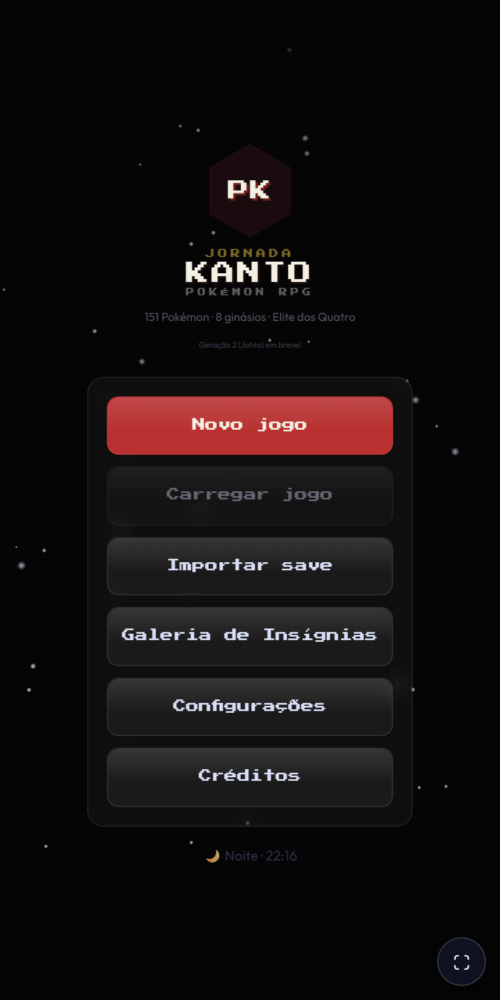
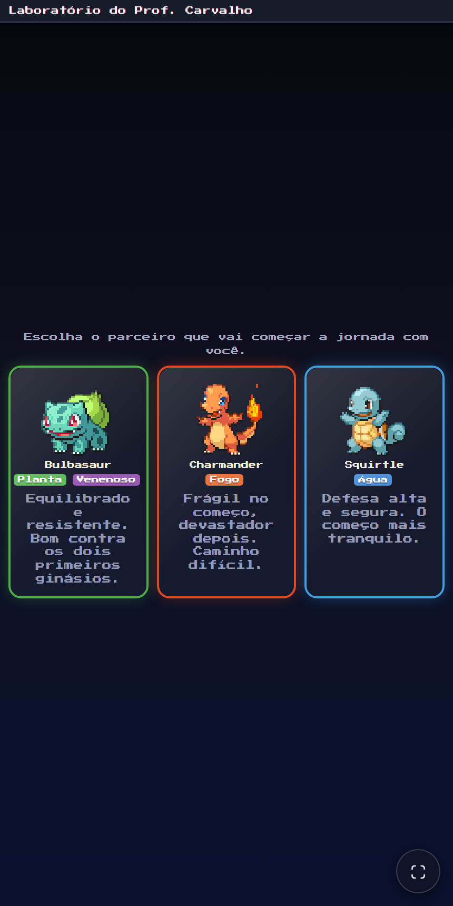
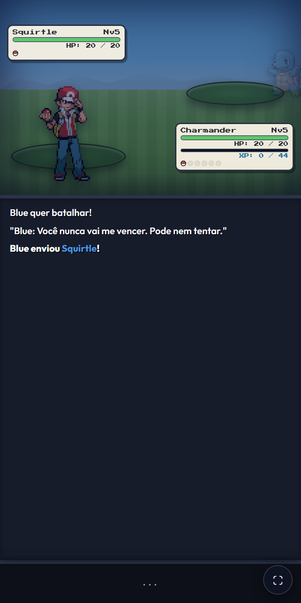
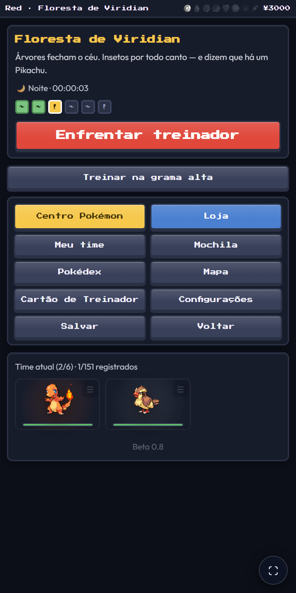

# Jornada Kanto — Pokémon RPG Web

Um RPG de turnos fiel e responsivo inspirado nos clássicos da franquia Pokémon, ambientado na região de Kanto. Desenvolvido inteiramente para a web com HTML5, CSS3 e JavaScript moderno, sem necessidade de emuladores ou dependências pesadas.

---

## Demonstração Visual

Abaixo estão algumas capturas de tela do jogo rodando diretamente no navegador:

| Tela Inicial | Escolha do Inicial |
| :---: | :---: |
|  |  |

| Sistema de Batalha | Exploração e Mapa |
| :---: | :---: |
|  |  |

---

## Funcionalidades Principais

- **151 Pokémon da Primeira Geração**: Base de dados completa com tipos, atributos base, lista de movimentos por nível e compatibilidade com Technical Machines (TMs).
- **Motor de Batalha em Turnos Completo**:
  - Mecânica de dano clássica baseada nas fórmulas oficiais.
  - Tabela de tipos completa com cálculo de fraquezas, imunidades e STAB (Same-Type Attack Boost).
  - Condições de status (Queimadura, Paralisia, Sono, Congelamento, Veneno) e acertos críticos.
  - Animações de ataque e sprites frontais/traseiros.
- **Progressão Fiel pela Região de Kanto**:
  - Encontros de rotas com taxas de aparição fiéis.
  - Desafio dos 8 Líderes de Ginásio (Brock, Misty, Lt. Surge, Erika, Koga, Sabrina, Blaine e Giovanni).
  - Confrontos contra o Rival e membros da Equipe Rocket.
  - Desafio final da Liga Pokémon (Elite dos Quatro e Campeão).
- **Modos de Jogo e Customização**:
  - **Dificuldades**: Fácil (com XP Share global), Normal e Difícil.
  - **Modo Nuzlocke**: Regra opcional onde Pokémon nocauteados são desativados permanentemente e há limites de captura por área.
- **Sistema de Salvamento e Gestão**:
  - Múltiplos slots de salvamento salvos no navegador (`localStorage`).
  - Função de exportação e importação de saves em formato JSON (permitindo continuar o progresso em qualquer dispositivo).
- **Design Retrô Moderno e Responsivo**:
  - Tipografia retrô com Press Start 2P combinada com layout limpo e intuitivo em Outfit.
  - Compatibilidade otimizada para Desktop e dispositivos móveis (formato compacto estilo smartphone).
  - Ciclo dinâmico de Dia e Noite integrado ao relógio do sistema.

---

## Estrutura do Projeto

```text
Poke-Jornadas/
├── css/
│   └── style.css            # Folha de estilos central e design retrô moderno
├── data/
│   ├── encounters.json      # Dados de encontros selvagens por rota
│   ├── learnsets.json       # Tabela de golpes aprendidos por nível
│   ├── moves.json           # Detalhes, poder, acurácia e efeitos de cada movimento
│   ├── pokemon.json         # Atributos base e estatísticas dos 151 Pokémon
│   ├── tm_compat.json       # Compatibilidade de TMs por espécie
│   └── type_chart.json      # Matriz de vantagens e fraquezas elementais
├── docs/
│   └── screenshots/         # Imagens de demonstração para a documentação
├── js/
│   ├── data.js              # Estruturas e constantes de dados em memória
│   └── main.js              # Lógica da interface, eventos de mapa e progressão
├── battle_engine.js         # Mecânicas de combate e cálculo de batalhas
├── fetch_poke_data.js       # Utilitário de sincronização de dados via PokéAPI
├── index.html               # Ponto de entrada modular do jogo
├── index-poke.html          # Versão consolidada standalone (tudo em um arquivo)
└── README.md                # Documentação técnica e guia do projeto
```

---

## Como Executar Localmente

Como o projeto é construído sobre tecnologias nativas da web, você pode executá-lo de forma direta:

### Opção 1: Servidor Local via Node.js

Se você tiver o Node.js instalado:

```bash
# Executa um servidor HTTP estático na porta 5000
npx serve .
```

Em seguida, acesse no seu navegador: `http://localhost:5000`

### Opção 2: Servidor Local via Python

Se você tiver o Python instalado:

```bash
# Para Python 3
python -m http.server 8000
```

Em seguida, acesse no seu navegador: `http://localhost:8000`

### Opção 3: Extensão Live Server (VS Code)

1. Abra a pasta do projeto no VS Code.
2. Clique com o botão direito sobre o arquivo `index.html`.
3. Selecione **Open with Live Server**.

---

## Tecnologias Utilizadas

- **HTML5 Semântico**: Estruturação de telas, menus e camadas da aplicação.
- **CSS3 / Flexbox / Grid**: Design modular, estilização glassmorphism, animações e responsividade.
- **JavaScript (ES6+)**: Lógica da máquina de estados do RPG, motor de combate e persistência.
- **PokéAPI**: Fonte de dados para metadados e sprites oficiais.

---

## Termos e Isenção de Responsabilidade

Este projeto foi criado estritamente para fins educacionais, de estudo de desenvolvimento web e homenagem aos jogos clássicos. Pokémon e todos os nomes relacionados são marcas registradas e propriedade intelectual de Nintendo, Game Freak e Creatures Inc.
